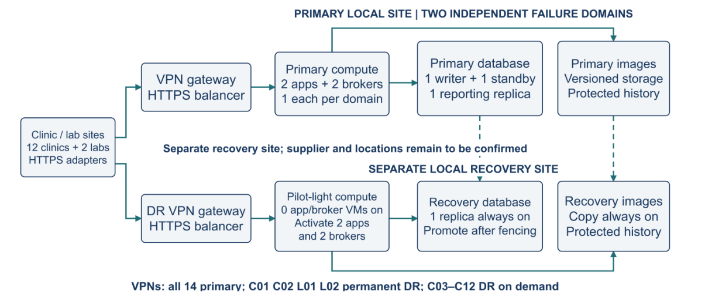

# MeridianCare Cloud Migration — Architecture & TCO Case Study

  

> **Academic consultancy case study, not a production deployment.** Architecture, sizing, recovery timings and pricing are planning estimates. No real patient data, deployed cloud environment, supplier agreement or tested SLA is claimed.

## Overview

MeridianCare Health Network is a fictional healthcare organization with **12 clinics and 2 diagnostic laboratories**. This SLIIT University **IE3100 — Virtualization and Cloud Computing Technologies** group project evaluates migrating ageing on-premises clinical infrastructure to a resilient cloud service.

The case considers end-of-life patient record database servers, slow access during the 9–11 a.m. peak, imaging growth of approximately **4 TB/year**, inconsistent backups, a missing formal disaster recovery site, a **10× registration surge for two weeks**, and integration of acquired clinics within **18 months**.

## Project objectives

- Design a resilient target architecture and compare cloud delivery models (IaaS, PaaS, SaaS).
- Target **at least 99.9% patient-facing availability** and **RTO under four hours**.
- Assess storage replication, protected backups, scaling and secure connectivity.
- Compare **three-year total cost of ownership (TCO)** against an on-premises baseline and evaluate the Board's **20% savings target**.
- Assess security, compliance, SLAs, risks, and procurement acceptance conditions.

## Proposed architecture



The preferred **procurement route** is a **local managed-cloud service**, conditional on equivalent supplier quotations, independent recovery sites, clinical compatibility, legal review, and demonstrated recovery. The report separately maps an **AWS Mumbai primary / Hyderabad recovery** configuration for comparative pricing; this is **not** the selected or deployed platform.

### Design features

| Area | Proposed approach |
|---|---|
| Applications | Two application VMs and two integration broker VMs across independent primary failure domains |
| Database | Writer, synchronous standby, reporting replica, and separate DR replica |
| Imaging | Object storage, protected version history and asynchronous DR copy |
| Networking | Clinic VPN connections, controlled routing, private application/data access and internal load balancing |
| Scaling | Measured autoscaling and temporary campaign capacity; **18 extra VMs are an untested cost allowance** |
| Recovery | Pilot-light DR with a **225-minute planning sequence**; **not a measured result** |
| Integration | Adapters and a broker for legacy clinic/lab systems with validation and reconciliation |

### Architecture diagrams

| Diagram | Preview |
|---|---|
| Target cloud architecture | [View](diagrams/01-target-cloud-architecture.png) |
| Workload distribution | [View](diagrams/02-workload-distribution.png) |
| Dynamic scalability | [View](diagrams/03-dynamic-scalability.png) |
| Redundant storage | [View](diagrams/04-redundant-storage.png) |
| Multi-device broker | [View](diagrams/05-multi-device-broker.png) |
| Distributed database | [View](diagrams/06-distributed-database.png) |

## Three-year cost comparison

The **uploaded final report** uses **USD, before tax**, with illustrative assumptions. The local-cloud figure is a **proposed supplier budget**, not a validated market quotation.

| Option | Illustrative 3-year TCO (USD) | Comparison |
|---|---:|---|
| Continued on-premises | **$348,000** | Baseline |
| Preferred local-cloud procurement budget | **$277,650** | **20.22% lower** than baseline, conditional on equivalent supplier offer |
| AWS priced comparator | **$353,507** | **1.6% higher** than baseline |

The Board's 20% reduction requires a cloud TCO **no greater than $278,400**. The local-cloud budget has only **$750 headroom** and remains commercially unproven; the report explicitly warns that supplier scope, recovery equivalence, tax and exchange rates may change the decision. **Do not interpret 20.22% as realized savings.**

See [Cost analysis notes](cost-analysis/README.md) and [the final report](docs/final-report.pdf) for assumptions and sensitivity.

## Cloud service model assessment

- **PRMS:** Retain an IaaS-hosted application with a compatible managed database where feasible.
- **Imaging:** Use infrastructure/object storage behind an approved PACS; object storage alone is not a PACS SaaS offering.
- **Billing:** Initially retain the existing application model with a compatible managed database; assess SaaS after workflow, audit and portability checks.

## SLAs and resilience targets

| Metric | Proposed target |
|---|---|
| Patient-facing availability | ≥99.9% per calendar month |
| Clinical record lookup | p95 ≤2 seconds |
| Registration | p95 ≤3 seconds |
| Disaster recovery RTO | Strictly <240 minutes; 225-minute **untested plan** |
| Transaction RPO | ≤15 minutes, subject to clinical approval |
| Imaging RPO | ≤24 hours, subject to clinical approval |

These are **proposed requirements**, not measured performance or provider guarantees.

## My contributions — Member 4

**R. M. S. S. Rathnayaka** — cloud service model comparisons (**Task 3a**), three-year TCO and pricing assessment (**Task 3b**), service quality and SLA planning (**Task 3c**), and mapping mechanisms to cloud characteristics (**Task 4c**). The proposal also assigns final presentation coordination to Member 4. This is a **group project**, and the architecture and other report sections were collaborative/assigned to teammates.

## Team credits

- **J. P. C. A. Jayasinghe** — conclusions, standards, risk, contracts, business case and report integration.
- **J. A. D. S. Jayakodi** — infrastructure, management, specialized and security mechanisms.
- **K. N. Munasinghe** — architecture diagrams, integration, disaster recovery, bill of materials and facilities assessment.
- **R. M. S. S. Rathnayaka** — service models, TCO, SLAs, cloud-characteristics mapping and final-deck coordination.

Credit allocations follow the project proposal; they are not claims of exclusive authorship of all shared material.

## Repository contents

```text
MeridianCare-Cloud-Migration/
├── README.md
├── docs/
│   ├── project-proposal.pdf
│   └── final-report.pdf
├── diagrams/
│   ├── 01-target-cloud-architecture.png
│   ├── 02-workload-distribution.png
│   ├── 03-dynamic-scalability.png
│   ├── 04-redundant-storage.png
│   ├── 05-multi-device-broker.png
│   └── 06-distributed-database.png
├── cost-analysis/
│   └── README.md
└── UPLOAD_TO_GITHUB.md
```

## Documents

- [Project proposal](docs/project-proposal.pdf)
- [Final report](docs/final-report.pdf)

## Disclaimer and sharing

This project was completed for coursework at **SLIIT University**. It is a hypothetical healthcare case study, not a clinical system or validated vendor recommendation. Rates, architectural assumptions, recovery budgets and legal considerations require verification before real-world use. Student registration numbers were removed from the included public-facing PDFs. **Confirm all group members consent to publishing the shared work before making this repository public.**

No open-source reuse license is granted by this repository; contact the authors for permission to reuse the work beyond GitHub's standard viewing/forking functionality.
